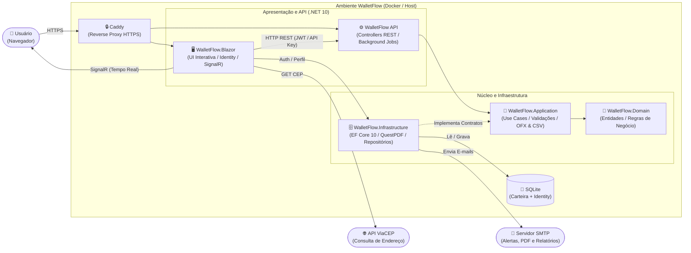

# WalletFlow.WebApi


[](https://github.com/leonardo-castriola/WalletFlow.WebApi/actions/workflows/ci.yml)
[-informational)](LICENSE)

> Aplicação de controle financeiro com API REST e interface Blazor para registrar receitas e despesas, consultar o extrato e acompanhar o saldo da carteira.

## Visão geral

O WalletFlow reúne uma API ASP.NET Core e uma aplicação web Blazor para organizar movimentações financeiras em receitas e despesas. Os dados são persistidos no SQLite e o saldo é calculado a partir das transações salvas. Pela interface, é possível consultar o painel, navegar pelo extrato paginado e filtrado e cadastrar novas movimentações.

## Funcionalidades

- Cadastro e consulta de transações.
- Edição e exclusão de transações próprias, com confirmação antes de excluir.
- Importação conciliada de extratos OFX e CSV: prévia antes de gravar, validação de linhas, identificação de duplicatas no histórico e no arquivo e confirmação dos lançamentos selecionados.
- Extrato paginado, com limite de 100 itens por página.
- Filtro por tipo (despesa ou receita) e por intervalo de datas, integrado à paginação.
- Envio do extrato filtrado por período ao endereço de e-mail da própria conta, como PDF anexado com todos os lançamentos e seus totais.
- Cálculo do saldo consolidado, inclusive quando o resultado é negativo.
- Painel financeiro com gráficos dos últimos seis meses: comparação de receitas, despesas e saldo mensal (receitas menos despesas) na mesma escala em reais; participação das receitas por mês; despesas mensais; e evolução do saldo acumulado em gráfico de área.
- Orçamento de despesas configurável por usuário e mês, definido por valor em reais ou por percentual da receita daquele período. Meses sem configuração própria reaproveitam automaticamente a configuração do mês configurado mais recente; percentuais são recalculados com a receita do mês selecionado.
- Alertas por SignalR e por e-mail quando as despesas atingem ou ultrapassam 100% do limite mensal. Cada usuário recebe no máximo um alerta por mês; uma configuração alterada pode habilitar um novo alerta para aquele período.
- Tooltips individuais nos pontos dos gráficos para consultar os valores de cada série e mês; valores e percentuais das receitas e despesas também ficam disponíveis junto às visualizações.
- Controles para mover os gráficos para cima ou para baixo no painel, com a ordem escolhida salva no navegador.
- Tema claro e escuro selecionável, com preferência persistente e sincronizada entre as páginas, inclusive antes e depois do login.
- Migrações do Entity Framework Core aplicadas durante a inicialização.
- Relatório financeiro mensal por e-mail, enviado em segundo plano no horário configurado, com controle persistido para evitar reenvios do mesmo período.
- Middleware global que registra exceções no servidor e responde com um erro seguro.
- Autenticação por chave de API fora do ambiente de desenvolvimento.
- Documentação interativa pelo Swagger em desenvolvimento.
- Interface web Blazor com página inicial autenticada, painel financeiro, extrato e cadastro de transações integrado à API. Após o login, o usuário é direcionado à página inicial (`/inicio`), que oferece atalhos para o painel e o extrato.
- Tela de login responsiva na rota `/`, com validação, alternância de visibilidade da senha e atalhos para cadastro e recuperação.
- Cadastro com confirmação de e-mail configurável (`Identity:RequireConfirmedEmail`), recuperação de senha por link enviado ao e-mail e proteção das rotas financeiras pelo ASP.NET Core Identity. No Compose de produção, a confirmação fica habilitada.
- Cadastro e atualização do perfil com nome completo, telefone, CPF e endereço; ao informar um CEP com oito dígitos, a tela consulta o ViaCEP e preenche logradouro, bairro, cidade e UF para conferência.
- Identificação do titular no relatório de movimentação financeira em PDF; a emissão exige que os dados cadastrais obrigatórios estejam completos.
- Filtros de tipo e período no extrato, preservando paginação e ordenação das movimentações mais recentes.
- Validação do formulário, confirmação após o cadastro e opção de cancelar sem persistir os dados.

## Tecnologias

- C# e .NET 10
- ASP.NET Core Web API
- Blazor Web App com componentes interativos no servidor
- Entity Framework Core 10
- SQLite
- QuestPDF 2026.5.0 para gerar o PDF do extrato (licença Community sujeita aos critérios de elegibilidade do [QuestPDF](https://www.questpdf.com/license/community.html)).
- Swagger / Swashbuckle
- xUnit

## Arquitetura

A solução separa o domínio, os casos de uso, a persistência e as interfaces externas em projetos distintos:

- `WalletFlow.Domain`: entidades e tipos centrais do negócio, sem dependência de banco ou ASP.NET Core.
- `WalletFlow.Application`: contratos, validações, importação de extratos e casos de uso; depende somente do domínio.
- `WalletFlow.Infrastructure`: Entity Framework Core, SQLite, Identity, repositórios e migrações; implementa as abstrações da aplicação.
- `WalletFlow`: API REST e autenticação HTTP. Os controllers encaminham as operações para os casos de uso.
- `WalletFlow.Blazor`: interface web e composição dos serviços de Identity e infraestrutura.
- `WalletFlow.Tests`: testes unitários das regras e serviços.
- `WalletFlow.IntegrationTests`: testes da API real com `WebApplicationFactory` e SQLite isolado por teste, incluindo persistência e isolamento entre usuários.
- `WalletFlow.BrowserTests`: testes de navegação da interface com Playwright e Google Chrome.

As dependências seguem em direção ao domínio: Infrastructure implementa contratos definidos pela Application, enquanto API e Blazor compõem essas camadas na inicialização. O `WalletDbContext` e as migrações ficam em `WalletFlow.Infrastructure`.

### Fluxo da arquitetura



## Pré-requisitos

- .NET SDK 10.0.400 (a versão está fixada em `global.json`)
- Visual Studio com suporte ao .NET 10 (opcional)
- Git

Confira o SDK instalado:

```bash
dotnet --version
```

## Instalação e execução

Clone o repositório e restaure os projetos:

```bash
git clone https://github.com/leonardo-castriola/WalletFlow.WebApi.git
cd WalletFlow.WebApi
dotnet restore WalletFlow.WebApi.slnx
```

### Executar API e interface Blazor

A interface Blazor chama a API no endereço configurado em `WalletFlow.Blazor/WalletFlow.Blazor/appsettings.Development.json` (`http://localhost:5250/` por padrão). Inicie os dois projetos em terminais separados:

```bash
dotnet run --project WalletFlow/WalletFlow.csproj --launch-profile http
```

```bash
dotnet run --project WalletFlow.Blazor/WalletFlow.Blazor/WalletFlow.Blazor.csproj --launch-profile http
```

Abra o frontend em [http://localhost:5087](http://localhost:5087). Após entrar, o sistema abre a página inicial autenticada (`/inicio`), com atalhos para o painel financeiro e o extrato. O Swagger da API fica em [http://localhost:5250/swagger](http://localhost:5250/swagger).

Os filtros de data do extrato consideram o fuso configurado em `Filters:TimeZoneId` no servidor Blazor. O padrão incluído é `America/Sao_Paulo`; ajuste esse valor para o fuso da carteira quando necessário. Valores monetários aceitam até duas casas decimais.

No Visual Studio, também é possível iniciar API e frontend simultaneamente usando a configuração `WalletFlow.WebApi.slnLaunch`.

### Visual Studio

1. Abra `WalletFlow.WebApi.slnx` no Visual Studio.
2. Inicie os projetos `WalletFlow` e `WalletFlow.Blazor` simultaneamente, ou selecione a configuração `WalletFlow.WebApi.slnLaunch`.
3. Pressione `Ctrl+F5` para iniciar sem conectar o depurador JavaScript do navegador. O perfil compartilhado abre o Swagger em `http://localhost:5250/swagger` e o login Blazor em `http://localhost:5087/`.
4. Na primeira inicialização, a API cria/atualiza o banco SQLite usando as migrações incluídas.

Também é possível aplicar as migrações pela Package Manager Console do Visual Studio:

```powershell
Update-Database -Project WalletFlow.Infrastructure -StartupProject WalletFlow
```

No terminal, restaure a ferramenta local do Entity Framework e aplique as migrações:

```bash
dotnet tool restore
dotnet ef database update --project WalletFlow.Infrastructure/WalletFlow.Infrastructure.csproj --startup-project WalletFlow/WalletFlow.csproj --context WalletDbContext
```

### Terminal

```bash
dotnet build WalletFlow.WebApi.slnx
dotnet test WalletFlow.WebApi.slnx
dotnet run --project WalletFlow/WalletFlow.csproj
```

Os testes de navegador usam o Google Chrome instalado e iniciam a aplicação Blazor com um banco SQLite temporário. O Google Chrome precisa estar instalado na máquina; os envios de e-mail não são realizados pelos testes.

Com o perfil local, abra [http://localhost:5250/swagger](http://localhost:5250/swagger). O banco `Wallet.db` é criado no diretório de conteúdo da aplicação. O arquivo é local e ignorado pelo Git.

## Autenticação

O Blazor usa cookies protegidos pelo ASP.NET Core Identity. A confirmação de e-mail é controlada por `Identity:RequireConfirmedEmail`: fica desabilitada por padrão em desenvolvimento e habilitada no Compose de produção. O SMTP envia as confirmações e os links de recuperação. O formulário de redefinição valida os dados recebidos, salva a nova senha pelo ASP.NET Core Identity e exibe a confirmação somente após a gravação. Se os campos não forem enviados ou o token for inválido, a página informa o problema e mantém a senha anterior. As senhas seguem a política do Identity (mínimo de 12 caracteres, letras maiúsculas e minúsculas, número e símbolo), com bloqueio temporário após cinco tentativas inválidas. A sessão é HttpOnly, SameSite=Lax, dura oito horas e é revalidada no circuito Blazor.

As tabelas do Identity e as transações ficam no mesmo SQLite. Em desenvolvimento, o host Blazor e a API já apontam para `WalletFlow/Wallet.db`. No Compose, ambos usam `/data/Wallet.db` no volume persistente; somente a API executa as migrações automaticamente (`Database__AutoMigrate=true`). Transações preexistentes ficam sem proprietário e não aparecem para nenhuma conta até serem associadas por um processo administrativo.

O host Blazor deriva o ID do usuário da sessão autenticada e emite um JWT assinado, com validade de três minutos, para cada chamada servidor-a-servidor. A API valida assinatura, emissor, audiência, validade e existência da conta; também exige a chave de serviço `X-API-Key` em produção. O ID não é aceito de cabeçalhos enviados pelo cliente. As consultas e alterações continuam limitadas ao proprietário. O Blazor e a API devem usar HTTPS; nenhuma dessas credenciais é enviada ao navegador.

O host Blazor usa SMTP para recuperação de senha e para enviar o extrato filtrado à própria conta. A API também usa SMTP para os relatórios mensais. Em desenvolvimento, os dois projetos compartilham o mesmo `UserSecretsId`; host, porta, usuário e remetente ficam em `appsettings.Development.json`, e a senha deve ficar nos User Secrets. Tokens de redefinição expiram após uma hora. Em produção, configure estes valores por variáveis de ambiente ou por um gerenciador de segredos; não grave credenciais no repositório:

```text
Identity__PublicBaseUrl=https://wallet.exemplo.com
Email__Smtp__Host=smtp.exemplo.com
Email__Smtp__Port=587
Email__Smtp__Username=...
Email__Smtp__Password=...
Email__Smtp__From=nao-responda@exemplo.com
Email__Smtp__ImplicitTls=false
ConnectionStrings__DefaultConnection=Data Source=/caminho/compartilhado/Wallet.db
Authentication__ApiKey=<mesma chave forte no host Blazor e na API>
Authentication__Jwt__SigningKey=<mesmo segredo aleatório com pelo menos 32 bytes no host Blazor e na API>
```

Em `Development`, o login fica em `http://localhost:5087/`; o campo de senha mantém o ícone de visualização dentro do controle. A senha SMTP local deve ser configurada nos User Secrets para testar a recuperação de senha, o envio do extrato e os relatórios. A API pode dispensar a chave de serviço em desenvolvimento, mas continua exigindo um JWT de usuário válido e existente.

Configure a senha SMTP localmente sem colocá-la nos arquivos versionados:

```powershell
dotnet user-secrets set "Email:Smtp:Password" "<senha-de-aplicativo>" --project WalletFlow.Blazor/WalletFlow.Blazor/WalletFlow.Blazor.csproj
dotnet user-secrets set "Authentication:Jwt:SigningKey" "<segredo-aleatorio-de-pelo-menos-32-bytes>" --project WalletFlow/WalletFlow.csproj
```

Exemplo no PowerShell:

```powershell
$env:ASPNETCORE_ENVIRONMENT = 'Production'
$env:Authentication__ApiKey = 'substitua-por-uma-chave-forte'
$env:Authentication__Jwt__SigningKey = 'substitua-por-um-segredo-aleatorio-de-pelo-menos-32-bytes'
dotnet run --project WalletFlow/WalletFlow.csproj --no-launch-profile
```

Configure as duas variáveis de autenticação no host Blazor e na API. O host envia `X-API-Key` e `Authorization: Bearer` apenas em chamadas servidor-a-servidor. Não coloque nenhuma dessas chaves no cliente ou no navegador.

## Como usar

O cliente Blazor envia a identidade autenticada automaticamente por JWT. A API rejeita chamadas que tentem definir o usuário por `X-User-ID`; em produção também exige `X-API-Key`. Não exponha o segredo de assinatura ou a chave de serviço em clientes públicos. O campo `tipo` usa `0` para despesa e `1` para receita.

| Método | Rota | O que faz |
| --- | --- | --- |
| `POST` | `/api/Transacao` | Cadastra uma transação para o usuário autenticado |
| `GET` | `/api/Transacao?page=1&pageSize=50` | Lista as transações do usuário com paginação |
| `GET` | `/api/Transacao/filtro?...` | Filtra as transações do usuário por tipo e período |
| `GET` | `/api/Transacao/{id}` | Consulta uma transação do próprio usuário |
| `PUT` | `/api/Transacao/{id}` | Atualiza descrição, valor e tipo de uma transação própria |
| `DELETE` | `/api/Transacao/{id}` | Exclui uma transação própria |
| `GET` | `/api/Transacao/saldo` | Retorna o saldo do próprio usuário |
| `GET` | `/api/Transacao/evolucao-mensal?ano=2026&mes=11` | Retorna os totais mensais dos últimos seis meses para os gráficos do painel |
| `GET` | `/api/Orcamento?ano=2026&mes=11` | Consulta limite, despesas e percentual utilizado no mês |
| `PUT` | `/api/Orcamento?ano=2026&mes=11` | Cria ou atualiza o limite mensal de despesas |
| `POST` | `/api/Orcamento/verificar-alerta?ano=2026&mes=11` | Verifica se as despesas atingiram o limite mensal e registra o alerta apenas uma vez por mês |
| `POST` | `/api/Transacao/importacao/previa` | Analisa arquivo OFX/CSV (multipart, campo `arquivo`) e retorna prévia e duplicatas |
| `POST` | `/api/Transacao/importacao` | Grava os lançamentos selecionados após revisão, ignorando duplicatas revalidadas |

O corpo de `PUT /api/Orcamento` aceita orçamento em reais ou percentual da receita:

```json
{ "limite": 5200.00, "modo": "valor" }
{ "limite": 0, "modo": "percentual", "percentual": 70 }
```

### Interface Blazor

| Página | Rota | O que permite fazer |
| --- | --- | --- |
| Entrar | `/` | Entrar com e-mail e senha |
| Criar conta | `/criar-conta` | Cadastrar conta e exibir confirmação de sucesso |
| Meu cadastro | `/meu-cadastro` | Consultar e atualizar nome, telefone, CPF e endereço; preencher parte do endereço pela consulta de CEP |
| Recuperar senha | `/esqueci-a-senha` | Solicitar link de redefinição por e-mail |
| Redefinir senha | `/redefinir-senha` | Definir senha usando token enviado por e-mail |
| Início autenticado | `/inicio` | Acessar o painel ou o extrato |
| Painel financeiro | `/painel` | Consultar saldo e movimentações recentes, visualizar gráficos dos últimos seis meses e personalizar sua ordem de apresentação |
| Orçamento mensal | `/orcamento` | Definir limite por valor ou percentual, reutilizar a última configuração em meses sem ajuste próprio e acompanhar despesas até o limite |
| Extrato | `/transacoes` | Consultar, filtrar e paginar transações |
| Nova transação | `/transacoes/nova` | Validar e cadastrar uma receita ou despesa |
| Editar transação | `/transacoes/editar/{id}` | Atualizar descrição, valor e tipo de uma transação própria |
| Importar extrato | `/transacoes/importar` | Analisar, revisar e importar lançamentos de arquivos OFX ou CSV |

Na importação CSV, use cabeçalhos `Data`, `Descrição` e `Valor`; `Tipo` é opcional quando o valor tiver sinal. São reconhecidos separadores por vírgula, ponto e vírgula e tabulação; valores decimais podem usar vírgula ou ponto. Para identificar duplicatas, o sistema compara data, tipo, valor e descrição normalizada. O arquivo pode ter até 5 MB e 500 lançamentos válidos por importação; linhas inválidas aparecem na revisão e não são gravadas. A data do lançamento importado é preservada no extrato.

O orçamento é geral para todas as despesas da conta no mês selecionado. A apuração respeita `Filters:TimeZoneId` (padrão `America/Sao_Paulo`). Ao consultar um mês sem configuração própria, o sistema aplica a configuração do mês configurado mais recente: valores fixos são reaproveitados e percentuais são recalculados com a receita daquele mês. Salvar no mês selecionado cria ou atualiza uma configuração específica para ele.

Quando as despesas alcançam ou ultrapassam 100% do limite, o sistema envia um alerta SignalR para as sessões conectadas do usuário e tenta enviar um e-mail ao endereço cadastrado. O alerta é processado uma vez por usuário e mês. O envio de e-mail requer SMTP funcional; falhas são registradas no log do servidor e não desfazem a movimentação financeira.

Na criação da conta e na tela “Meu cadastro”, a consulta do CEP usa o serviço público [ViaCEP](https://viacep.com.br/) para localizar logradouro, bairro, cidade e UF. O CEP é enviado ao serviço quando os oito dígitos são informados; confira os dados retornados e preencha o número e o complemento. Se a consulta falhar ou o CEP não for encontrado, os campos podem ser preenchidos manualmente. O PDF enviado por e-mail inclui os dados de identificação e endereço do titular.

Ao salvar uma transação válida, a aplicação persiste os dados pela API e exibe a confirmação. Fechar a mensagem limpa o formulário. Cancelar limpa os campos sem enviar um cadastro.

Os endpoints da API são consumidos pelo host Blazor em chamadas servidor-a-servidor. Chamadas diretas precisam apresentar um JWT assinado por um emissor confiável e, em produção, também a chave de serviço; informar `X-User-ID` não concede identidade nem acesso.

Na listagem, `page` começa em `1`; `pageSize` aceita valores de `1` a `100` e, por padrão, é `50`. O filtro aceita qualquer combinação de `tipo`, `dataInicio` e `dataFim`. As datas devem seguir ISO 8601; quando ambas são informadas, `dataInicio` precisa ser anterior ou igual a `dataFim`. A resposta paginada contém `items`, `page`, `pageSize`, `totalCount` e `totalPages`.

## Swagger em execução

As imagens abaixo foram capturadas na interface Swagger local, com a aplicação executando e respostas reais dos endpoints. A demonstração usa um banco temporário separado do banco local do projeto.

### Cadastro — `POST /api/Transacao`


### Extrato paginado — `GET /api/Transacao`


### Filtro por tipo, período e página — `GET /api/Transacao/filtro`


### Consulta por ID — `GET /api/Transacao/{id}`


### Saldo — `GET /api/Transacao/saldo`


## Testes

Os testes xUnit cobrem regras unitárias, comportamento da API e integração ponta a ponta entre endpoints e persistência. A suíte unitária verifica importação OFX/CSV, valores e datas, classificação por sinal, erros por linha e detecção de duplicatas no mesmo arquivo. A suíte de integração usa `WebApplicationFactory` e um banco SQLite temporário isolado, sem acessar o banco de desenvolvimento, para verificar duplicatas contra o histórico e entre contas, confirmação sem relançar duplicatas, autenticação/autorização, isolamento de orçamento, validação do período e do limite e registro de alerta ao atingir o limite mensal.

```bash
dotnet test WalletFlow.WebApi.slnx
```

## Implantação com Docker

A solução inclui Dockerfiles para a API e o Blazor, um `docker-compose.yml` com Caddy como proxy HTTPS, verificações de saúde e volumes persistentes, além de uma rotina de backup SQLite criptografado. Antes da implantação:

1. Configure os registros DNS de `BLAZOR_DOMAIN` e `API_DOMAIN` para apontarem ao servidor. Libere as portas 80 e 443 para que o Caddy emita e renove os certificados TLS.
2. Copie `.env.example` para `.env` e substitua todos os exemplos por domínios e credenciais reais. Gere valores fortes e distintos para as chaves de API, assinatura JWT e criptografia de backups; use os mesmos valores de API/JWT no host Blazor e na API. Não versione nem compartilhe o `.env`.
3. Configure SMTP para confirmação de cadastro, recuperação de senha, extratos e alertas. Se os backups precisarem ficar fora do servidor, configure `BACKUP_OFFSITE_PATH` para um armazenamento externo montado ou implemente `BACKUP_OFFSITE_CMD`; o valor padrão cria uma pasta local e não é uma cópia externa.
4. Execute a validação de configuração e inicie os serviços:

```bash
cp .env.example .env
./scripts/preflight-check.sh
docker compose up -d --build
```

No PowerShell, a cópia pode ser feita com `Copy-Item .env.example .env`; o script de pré-validação deve ser executado em um ambiente com shell compatível. O serviço `walletflow-pre-migrate-backup` cria um backup antes da primeira migração quando já existe um banco. A API aplica as migrações; o Blazor aguarda a API saudável. Os endpoints `/health` são usados pelo Compose para verificar os serviços.

O banco e as chaves de Data Protection ficam no volume Docker `walletflow-data`; os backups periódicos são criptografados e mantidos conforme `BACKUP_RETENTION_DAYS`. Preserve as chaves de criptografia e mantenha cópias de backup acessíveis antes de atualizar. O pipeline `.github/workflows/ci.yml` valida restauração, auditoria de dependências, compilação, testes e configuração do Compose; a validação de configuração não substitui um teste de build e implantação no servidor de destino.

## Relatórios mensais por e-mail

A API pode enviar, no primeiro dia de cada mês às 08:00 (horário de São Paulo), um resumo das receitas, despesas, saldo e quantidade de movimentações do mês anterior. O agendador verifica pendências a cada hora, envia apenas para contas com e-mail confirmado e registra cada envio para não repetir o mesmo relatório. A tabela de controle é criada pela migração do Entity Framework durante a inicialização.

O recurso fica desativado por padrão. Para habilitá-lo no ambiente de desenvolvimento, configure a opção no User Secrets da API:

```bash
dotnet user-secrets set "Reports:Monthly:Enabled" "true" --project WalletFlow/WalletFlow.csproj
```

A API e o host Blazor compartilham o mesmo `UserSecretsId` local, então as credenciais SMTP já configuradas para o Blazor também ficam disponíveis para a API. Em produção, configure `Reports__Monthly__Enabled=true` e as variáveis `Email__Smtp__Host`, `Email__Smtp__Port`, `Email__Smtp__Username`, `Email__Smtp__Password` e `Email__Smtp__From` no ambiente do servidor.

## Alertas de orçamento por e-mail

Além do resumo mensal, a API tenta enviar uma notificação quando as despesas de um usuário atingem ou ultrapassam o limite configurado para o mês. O cálculo usa o valor em reais ou o limite derivado do percentual da receita. O alerta por e-mail é processado uma vez no mês e usa as mesmas credenciais SMTP descritas acima; a interface também exibe a notificação em tempo real via SignalR quando o usuário está conectado.

## Padrões de desenvolvimento

1. Crie uma branch para sua alteração.
2. Faça alterações focadas e commits atômicos com mensagens Conventional Commits, por exemplo `feat: adiciona filtro por período`.
3. Execute `dotnet build WalletFlow.WebApi.slnx` e `dotnet test WalletFlow.WebApi.slnx`.
4. Valide a mudança localmente com a suíte de testes antes de integrar.

## Licença

Copyright (c) 2026 Leonardo Castriola. Todos os direitos reservados.

Este é um **projeto proprietário disponibilizado publicamente para fins de portfólio e avaliação técnica**. A visualização do código e a execução local para avaliação são permitidas, mas a comercialização, modificação e redistribuição por terceiros não são autorizadas.

As bibliotecas e pacotes de terceiros utilizados pela solução permanecem regidos por suas respectivas licenças originais. Consulte o arquivo [LICENSE](LICENSE) para os termos completos.
