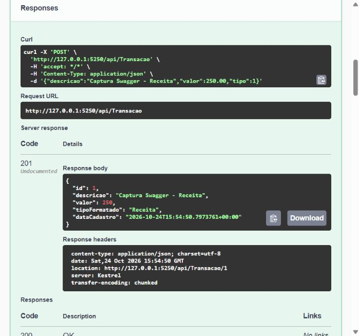
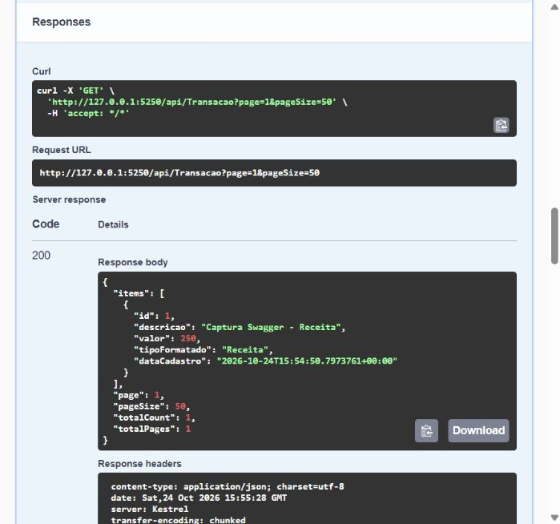
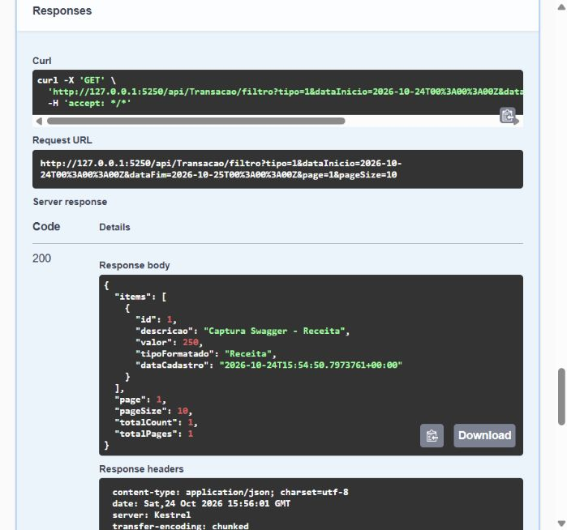
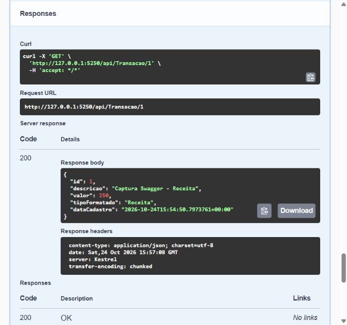
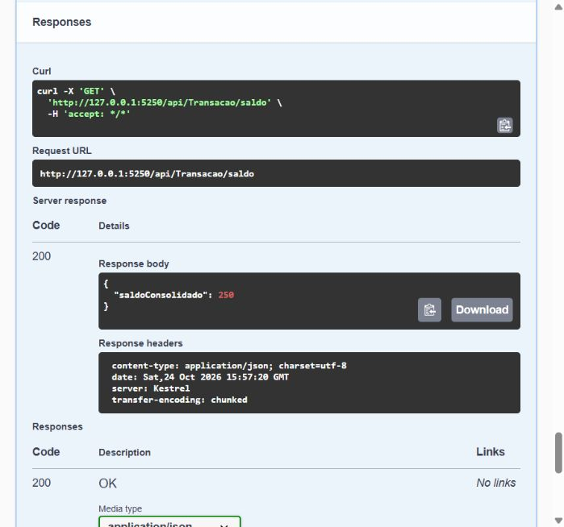

# WalletFlow.WebApi


> Aplicação de controle financeiro com API REST e interface Blazor para registrar receitas e despesas, consultar o extrato e acompanhar o saldo da carteira.

## Visão geral

O WalletFlow reúne uma API ASP.NET Core e uma aplicação web Blazor para organizar movimentações financeiras em receitas e despesas. Os dados são persistidos no SQLite e o saldo é calculado a partir das transações salvas. Pela interface, é possível consultar o painel, navegar pelo extrato paginado e filtrado e cadastrar novas movimentações.

## Funcionalidades

- Cadastro e consulta de transações.
- Edição e exclusão de transações próprias, com confirmação antes de excluir.
- Importação conciliada de extratos OFX e CSV: prévia antes de gravar, validação de linhas, identificação de duplicatas no histórico e no arquivo e confirmação dos lançamentos selecionados.
- Extrato paginado, com limite de 100 itens por página.
- Filtro por tipo (despesa ou receita) e por intervalo de datas, integrado à paginação.
- Cálculo do saldo consolidado, inclusive quando o resultado é negativo.
- Painel financeiro com gráficos dos últimos seis meses: comparação de receitas, despesas e saldo na mesma escala em reais; participação das receitas por mês; despesas mensais; e evolução do saldo acumulado em gráfico de área.
- Tooltips individuais nos pontos dos gráficos para consultar os valores de cada série e mês; valores e percentuais das receitas e despesas também ficam disponíveis junto às visualizações.
- Controles para mover os gráficos para cima ou para baixo no painel, com a ordem escolhida salva no navegador.
- Migrações do Entity Framework Core aplicadas durante a inicialização.
- Middleware global que registra exceções no servidor e responde com um erro seguro.
- Autenticação por chave de API fora do ambiente de desenvolvimento.
- Documentação interativa pelo Swagger em desenvolvimento.
- Interface web Blazor com página inicial, painel de saldo, extrato e cadastro de transações integrado à API.
- Tela de login responsiva na rota `/`, com validação, alternância de visibilidade da senha e atalhos para cadastro e recuperação.
- Cadastro sem confirmação por e-mail, recuperação de senha por link enviado ao e-mail e proteção das rotas financeiras pelo ASP.NET Core Identity.
- Filtros de tipo e período no extrato, preservando paginação e ordenação das movimentações mais recentes.
- Validação do formulário, confirmação após o cadastro e opção de cancelar sem persistir os dados.

## Tecnologias

- C# e .NET 10
- ASP.NET Core Web API
- Blazor Web App com componentes interativos no servidor
- Entity Framework Core 10
- SQLite
- Swagger / Swashbuckle
- xUnit

## Arquitetura

A solução separa o domínio, os casos de uso, a persistência e as interfaces externas em projetos distintos:

- `WalletFlow.Domain`: entidades e tipos centrais do negócio, sem dependência de banco ou ASP.NET Core.
- `WalletFlow.Application`: contratos, validações, importação de extratos e casos de uso; depende somente do domínio.
- `WalletFlow.Infrastructure`: Entity Framework Core, SQLite, Identity, repositórios e migrações; implementa as abstrações da aplicação.
- `WalletFlow`: API REST e autenticação HTTP. Os controllers encaminham as operações para os casos de uso.
- `WalletFlow.Blazor`: interface web e composição dos serviços de Identity e infraestrutura.
- `WalletFlow.Tests`: testes unitários das regras e serviços.
- `WalletFlow.IntegrationTests`: testes da API real com `WebApplicationFactory` e SQLite isolado por teste, incluindo persistência e isolamento entre usuários.
- `WalletFlow.BrowserTests`: testes de navegação da interface com Playwright e Google Chrome.

As dependências seguem em direção ao domínio: Infrastructure implementa contratos definidos pela Application, enquanto API e Blazor compõem essas camadas na inicialização. O `WalletDbContext` e as migrações ficam em `WalletFlow.Infrastructure`.

## Pré-requisitos

- .NET SDK 10.0.400 (a versão está fixada em `global.json`)
- Visual Studio com suporte ao .NET 10 (opcional)
- Git

Confira o SDK instalado:

```bash
dotnet --version
```

## Instalação e execução

Clone o repositório e restaure os projetos:

```bash
git clone https://github.com/leonardo-castriola/WalletFlow.WebApi.git
cd WalletFlow.WebApi
dotnet restore WalletFlow.WebApi.slnx
```

### Executar API e interface Blazor

A interface Blazor chama a API no endereço configurado em `WalletFlow.Blazor/WalletFlow.Blazor/appsettings.Development.json` (`http://localhost:5250/` por padrão). Inicie os dois projetos em terminais separados:

```bash
dotnet run --project WalletFlow/WalletFlow.csproj --launch-profile http
```

```bash
dotnet run --project WalletFlow.Blazor/WalletFlow.Blazor/WalletFlow.Blazor.csproj --launch-profile http
```

Abra o frontend em [http://localhost:5087](http://localhost:5087). A página inicial oferece links para o painel financeiro, o extrato e o cadastro. O Swagger da API fica em [http://localhost:5250/swagger](http://localhost:5250/swagger).

Os filtros de data do extrato consideram o fuso configurado em `Filters:TimeZoneId` no servidor Blazor. O padrão incluído é `America/Sao_Paulo`; ajuste esse valor para o fuso da carteira quando necessário. Valores monetários aceitam até duas casas decimais.

No Visual Studio, também é possível iniciar API e frontend simultaneamente usando a configuração `WalletFlow.WebApi.slnLaunch`.

### Visual Studio

1. Abra `WalletFlow.WebApi.slnx` no Visual Studio.
2. Inicie os projetos `WalletFlow` e `WalletFlow.Blazor` simultaneamente, ou selecione a configuração `WalletFlow.WebApi.slnLaunch`.
3. Pressione `Ctrl+F5` para iniciar sem conectar o depurador JavaScript do navegador. O perfil compartilhado abre o Swagger em `http://localhost:5250/swagger` e o login Blazor em `http://localhost:5087/`.
4. Na primeira inicialização, a API cria/atualiza o banco SQLite usando as migrações incluídas.

Também é possível aplicar as migrações pela Package Manager Console do Visual Studio:

```powershell
Update-Database -Project WalletFlow.Infrastructure -StartupProject WalletFlow
```

No terminal, restaure a ferramenta local do Entity Framework e aplique as migrações:

```bash
dotnet tool restore
dotnet ef database update --project WalletFlow.Infrastructure/WalletFlow.Infrastructure.csproj --startup-project WalletFlow/WalletFlow.csproj --context WalletDbContext
```

### Terminal

```bash
dotnet build WalletFlow.WebApi.slnx
dotnet test WalletFlow.WebApi.slnx
dotnet run --project WalletFlow/WalletFlow.csproj
```

Os testes de navegador usam o Google Chrome instalado e iniciam a aplicação Blazor com um banco SQLite temporário. O Google Chrome precisa estar instalado na máquina; os envios de e-mail não são realizados pelos testes.

Com o perfil local, abra [http://localhost:5250/swagger](http://localhost:5250/swagger). O banco `Wallet.db` é criado no diretório de conteúdo da aplicação. O arquivo é local e ignorado pelo Git.

## Autenticação

O Blazor usa cookies protegidos pelo ASP.NET Core Identity. O cadastro confirma a conta na própria criação e exibe uma mensagem de sucesso, sem enviar e-mail; o SMTP é usado para recuperação de senha. O formulário de redefinição valida os dados recebidos, salva a nova senha pelo ASP.NET Core Identity e exibe a confirmação somente após a gravação. Se os campos não forem enviados ou o token for inválido, a página informa o problema e mantém a senha anterior. As senhas seguem a política do Identity (mínimo de 12 caracteres, letras maiúsculas e minúsculas, número e símbolo), com bloqueio temporário após cinco tentativas inválidas. A sessão é HttpOnly, SameSite=Lax, dura oito horas e é revalidada no circuito Blazor.

As tabelas do Identity e as transações ficam no mesmo SQLite. Em desenvolvimento, o host Blazor e a API já apontam para `WalletFlow/Wallet.db`. Em produção, configure o mesmo caminho absoluto em `ConnectionStrings__DefaultConnection` para os dois processos. As migrações são aplicadas na inicialização. Transações preexistentes ficam sem proprietário e não aparecem para nenhuma conta até serem associadas por um processo administrativo.

O host Blazor deriva o ID do usuário da sessão autenticada e envia esse ID à API em uma chamada servidor-a-servidor. A API valida a conta e restringe consulta, criação, edição, exclusão, listagem e saldo ao proprietário da transação. Em produção, mantenha a chave de serviço em `Authentication__ApiKey` nos dois processos; ela nunca é enviada pelo navegador. O Blazor e a API devem usar HTTPS.

Para recuperação de senha, configure SMTP no host Blazor. Tokens de redefinição expiram após uma hora. Configure estes valores por variáveis de ambiente ou por um gerenciador de segredos; não grave credenciais no repositório:

```text
Identity__PublicBaseUrl=https://wallet.exemplo.com
Email__Smtp__Host=smtp.exemplo.com
Email__Smtp__Port=587
Email__Smtp__Username=...
Email__Smtp__Password=...
Email__Smtp__From=nao-responda@exemplo.com
Email__Smtp__ImplicitTls=false
ConnectionStrings__DefaultConnection=Data Source=/caminho/compartilhado/Wallet.db
Authentication__ApiKey=<mesma chave forte no host Blazor e na API>
```

Em `Development`, o login fica em `http://localhost:5087/`; o campo de senha mantém o ícone de visualização dentro do controle. Configure host, porta, remetente, usuário e senha SMTP nos User Secrets do projeto `WalletFlow.Blazor` para testar a recuperação de senha. A API permite chamadas de desenvolvimento sem a chave de serviço, mas ainda exige um `X-User-ID` correspondente a uma conta existente.

Exemplo no PowerShell:

```powershell
$env:ASPNETCORE_ENVIRONMENT = 'Production'
$env:Authentication__ApiKey = 'substitua-por-uma-chave-forte'
dotnet run --project WalletFlow/WalletFlow.csproj --no-launch-profile
```

O host Blazor inclui `X-API-Key` e `X-User-ID` nas chamadas servidor-a-servidor. Não coloque a chave de API no cliente ou no navegador.

## Como usar

O cliente Blazor envia a identidade autenticada automaticamente. Para chamadas diretas de desenvolvimento, envie `X-User-ID` com o ID de uma conta existente; fora de `Development`, envie também a chave de serviço `X-API-Key`. O cabeçalho de usuário deve ser definido por um serviço confiável, nunca por um cliente público. O campo `tipo` usa `0` para despesa e `1` para receita.

| Método | Rota | O que faz |
| --- | --- | --- |
| `POST` | `/api/Transacao` | Cadastra uma transação para o usuário autenticado |
| `GET` | `/api/Transacao?page=1&pageSize=50` | Lista as transações do usuário com paginação |
| `GET` | `/api/Transacao/filtro?...` | Filtra as transações do usuário por tipo e período |
| `GET` | `/api/Transacao/{id}` | Consulta uma transação do próprio usuário |
| `PUT` | `/api/Transacao/{id}` | Atualiza descrição, valor e tipo de uma transação própria |
| `DELETE` | `/api/Transacao/{id}` | Exclui uma transação própria |
| `GET` | `/api/Transacao/saldo` | Retorna o saldo do próprio usuário |
| `GET` | `/api/Transacao/evolucao-mensal?ano=2026&mes=11` | Retorna os totais mensais dos últimos seis meses para os gráficos do painel |
| `POST` | `/api/Transacao/importacao/previa` | Analisa arquivo OFX/CSV (multipart, campo `arquivo`) e retorna prévia e duplicatas |
| `POST` | `/api/Transacao/importacao` | Grava os lançamentos selecionados após revisão, ignorando duplicatas revalidadas |

### Interface Blazor

| Página | Rota | O que permite fazer |
| --- | --- | --- |
| Entrar | `/` | Entrar com e-mail e senha |
| Criar conta | `/criar-conta` | Cadastrar conta e exibir confirmação de sucesso |
| Recuperar senha | `/esqueci-a-senha` | Solicitar link de redefinição por e-mail |
| Redefinir senha | `/redefinir-senha` | Definir senha usando token enviado por e-mail |
| Início autenticado | `/inicio` | Acessar o painel ou o extrato |
| Painel financeiro | `/painel` | Consultar saldo e movimentações recentes, visualizar gráficos dos últimos seis meses e personalizar sua ordem de apresentação |
| Extrato | `/transacoes` | Consultar, filtrar e paginar transações |
| Nova transação | `/transacoes/nova` | Validar e cadastrar uma receita ou despesa |
| Editar transação | `/transacoes/editar/{id}` | Atualizar descrição, valor e tipo de uma transação própria |
| Importar extrato | `/transacoes/importar` | Analisar, revisar e importar lançamentos de arquivos OFX ou CSV |

Na importação CSV, use cabeçalhos `Data`, `Descrição` e `Valor`; `Tipo` é opcional quando o valor tiver sinal. São reconhecidos separadores por vírgula, ponto e vírgula e tabulação; valores decimais podem usar vírgula ou ponto. Para identificar duplicatas, o sistema compara data, tipo, valor e descrição normalizada. O arquivo pode ter até 5 MB e 500 lançamentos válidos por importação; linhas inválidas aparecem na revisão e não são gravadas. A data do lançamento importado é preservada no extrato.

Ao salvar uma transação válida, a aplicação persiste os dados pela API e exibe a confirmação. Fechar a mensagem limpa o formulário. Cancelar limpa os campos sem enviar um cadastro.

Exemplo de cadastro:

```bash
curl -X POST http://localhost:5250/api/Transacao \
  -H "Content-Type: application/json" \
  -H "X-User-ID: <id-da-sua-conta>" \
  -d '{"descricao":"Salário","valor":3500.00,"tipo":1}'
```

Na listagem, `page` começa em `1`; `pageSize` aceita valores de `1` a `100` e, por padrão, é `50`. O filtro aceita qualquer combinação de `tipo`, `dataInicio` e `dataFim`. As datas devem seguir ISO 8601; quando ambas são informadas, `dataInicio` precisa ser anterior ou igual a `dataFim`. A resposta paginada contém `items`, `page`, `pageSize`, `totalCount` e `totalPages`.

## Swagger em execução

As imagens abaixo foram capturadas na interface Swagger local, com a aplicação executando e respostas reais dos endpoints. A demonstração usa um banco temporário separado do banco local do projeto.

### Cadastro — `POST /api/Transacao`



### Extrato paginado — `GET /api/Transacao`



### Filtro por tipo, período e página — `GET /api/Transacao/filtro`



### Consulta por ID — `GET /api/Transacao/{id}`



### Saldo — `GET /api/Transacao/saldo`



## Testes

Os testes xUnit cobrem regras unitárias, comportamento da API e integração ponta a ponta entre endpoints e persistência. Os testes de integração usam `WebApplicationFactory` e um banco SQLite temporário isolado, sem acessar o banco de desenvolvimento.

```bash
dotnet test WalletFlow.WebApi.slnx
```

## Como contribuir

1. Crie uma branch para sua alteração.
2. Faça alterações focadas e commits atômicos com mensagens Conventional Commits, por exemplo `feat: adiciona filtro por período`.
3. Execute `dotnet build WalletFlow.WebApi.slnx` e `dotnet test WalletFlow.WebApi.slnx`.
4. Abra um Pull Request explicando a mudança e como ela foi verificada.

## Licença

Este repositório ainda não define uma licença. Até que uma licença seja adicionada, todos os direitos permanecem reservados aos titulares do projeto.
