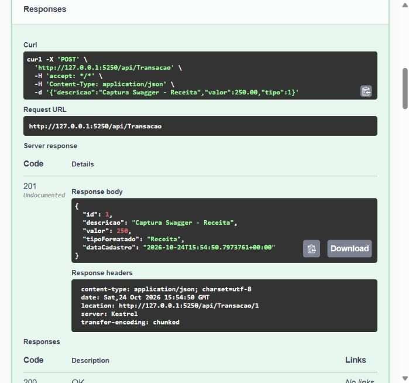
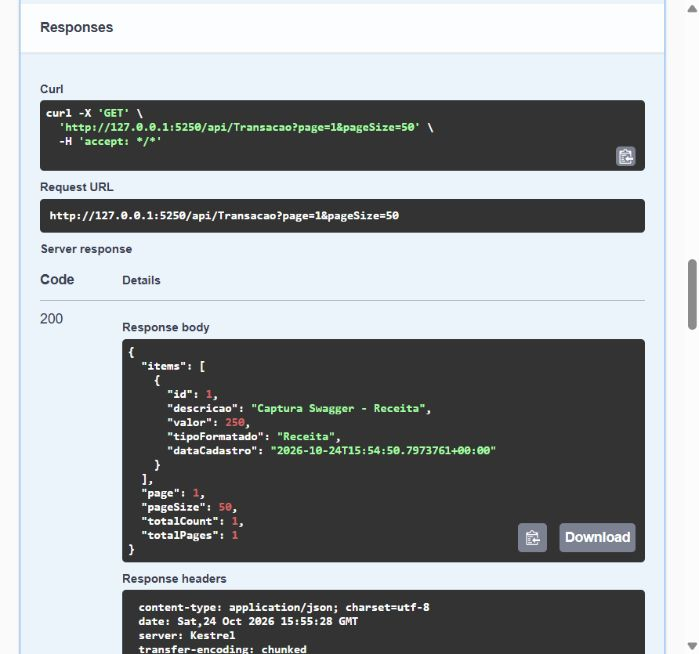
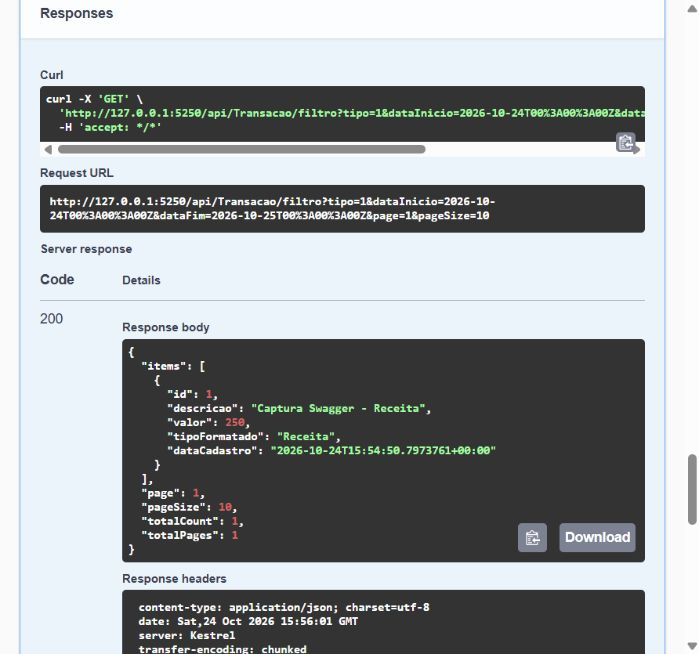
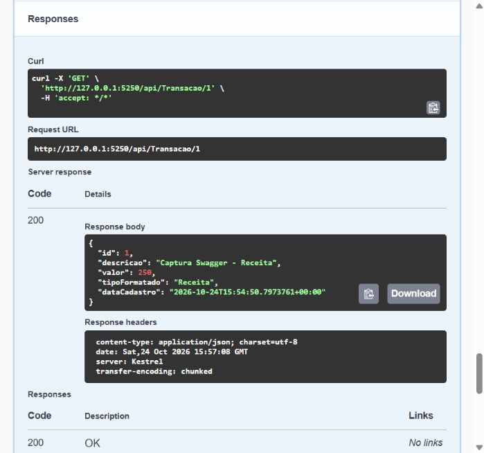
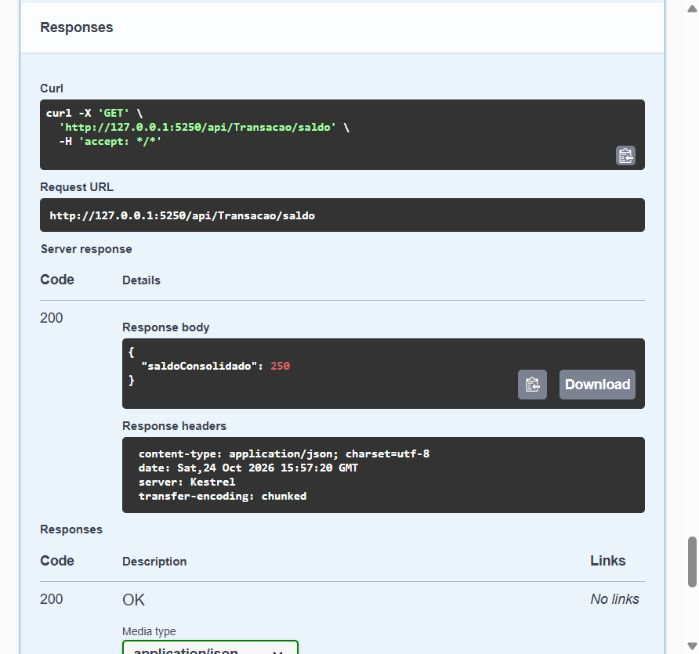

# WalletFlow.WebApi


> Aplicação de controle financeiro com API REST e interface Blazor para registrar receitas e despesas, consultar o extrato e acompanhar o saldo da carteira.

## Visão geral

O WalletFlow reúne uma API ASP.NET Core e uma aplicação web Blazor para organizar movimentações financeiras em receitas e despesas. Os dados são persistidos no SQLite e o saldo é calculado a partir das transações salvas. Pela interface, é possível consultar o painel, navegar pelo extrato paginado e filtrado e cadastrar novas movimentações.

## Funcionalidades

- Cadastro e consulta de transações.
- Extrato paginado, com limite de 100 itens por página.
- Filtro por tipo (despesa ou receita) e por intervalo de datas, integrado à paginação.
- Cálculo do saldo consolidado, inclusive quando o resultado é negativo.
- Migrações do Entity Framework Core aplicadas durante a inicialização.
- Middleware global que registra exceções no servidor e responde com um erro seguro.
- Autenticação por chave de API fora do ambiente de desenvolvimento.
- Documentação interativa pelo Swagger em desenvolvimento.
- Interface web Blazor com página inicial, painel de saldo, extrato e cadastro de transações integrado à API.
- Filtros de tipo e período no extrato, preservando paginação e ordenação das movimentações mais recentes.
- Validação do formulário, confirmação após o cadastro e opção de cancelar sem persistir os dados.

## Tecnologias

- C# e .NET 10
- ASP.NET Core Web API
- Blazor Web App com componentes interativos no servidor
- Entity Framework Core 10
- SQLite
- Swagger / Swashbuckle
- xUnit

## Pré-requisitos

- .NET 10 SDK
- Visual Studio com suporte ao .NET 10 (opcional)
- Git

Confira o SDK instalado:

```bash
dotnet --version
```

## Instalação e execução

Clone o repositório e restaure os projetos:

```bash
git clone https://github.com/leonardo-castriola/WalletFlow.WebApi.git
cd WalletFlow.WebApi
dotnet restore WalletFlow.WebApi.slnx
```

### Executar API e interface Blazor

A interface Blazor chama a API no endereço configurado em `WalletFlow.Blazor/WalletFlow.Blazor/appsettings.Development.json` (`http://localhost:5250/` por padrão). Inicie os dois projetos em terminais separados:

```bash
dotnet run --project WalletFlow/WalletFlow.csproj --launch-profile http
```

```bash
dotnet run --project WalletFlow.Blazor/WalletFlow.Blazor/WalletFlow.Blazor.csproj --launch-profile http
```

Abra o frontend em [http://localhost:5087](http://localhost:5087). A página inicial oferece links para o painel financeiro, o extrato e o cadastro. O Swagger da API fica em [http://localhost:5250/swagger](http://localhost:5250/swagger).

Os filtros de data do extrato consideram o fuso configurado em `Filters:TimeZoneId` no servidor Blazor. O padrão incluído é `America/Sao_Paulo`; ajuste esse valor para o fuso da carteira quando necessário. Valores monetários aceitam até duas casas decimais.

No Visual Studio, também é possível iniciar API e frontend simultaneamente usando a configuração `WalletFlow.WebApi.slnLaunch`.

### Visual Studio

1. Abra `WalletFlow.WebApi.slnx` no Visual Studio.
2. Inicie os projetos `WalletFlow` e `WalletFlow.Blazor` simultaneamente, ou selecione a configuração `WalletFlow.WebApi.slnLaunch`.
3. Pressione `F5` ou `Ctrl+F5`. A API abre o Swagger e o frontend Blazor abre em uma janela própria.
4. Na primeira inicialização, a API cria/atualiza o banco SQLite usando as migrações incluídas.

Também é possível aplicar as migrações pela Package Manager Console do Visual Studio:

```powershell
Update-Database -Project WalletFlow -StartupProject WalletFlow
```

### Terminal

```bash
dotnet build WalletFlow.WebApi.slnx
dotnet test WalletFlow.WebApi.slnx
dotnet run --project WalletFlow/WalletFlow.csproj
```

Com o perfil local, abra [http://localhost:5250/swagger](http://localhost:5250/swagger). O banco `Wallet.db` é criado no diretório de conteúdo da aplicação. O arquivo é local e ignorado pelo Git.

## Autenticação

Em `Development`, as rotas podem ser usadas sem chave. Nos outros ambientes, configure uma chave forte pela variável de ambiente `Authentication__ApiKey`; nunca coloque a chave no repositório.

Exemplo no PowerShell:

```powershell
$env:ASPNETCORE_ENVIRONMENT = 'Production'
$env:Authentication__ApiKey = 'substitua-por-uma-chave-forte'
dotnet run --project WalletFlow/WalletFlow.csproj --no-launch-profile
```

Envie a chave no cabeçalho `X-API-Key` em cada requisição.

## Como usar

Explore e execute as operações em [Swagger](http://localhost:5250/swagger). O campo `tipo` usa `0` para despesa e `1` para receita.

| Método | Rota | O que faz |
| --- | --- | --- |
| `POST` | `/api/Transacao` | Cadastra uma transação |
| `GET` | `/api/Transacao?page=1&pageSize=50` | Lista transações com paginação |
| `GET` | `/api/Transacao/filtro?tipo=1&dataInicio=2026-10-01T00:00:00Z&dataFim=2026-10-31T23:59:59Z&page=1&pageSize=10` | Filtra por tipo e período, mantendo a paginação |
| `GET` | `/api/Transacao/{id}` | Consulta uma transação pelo ID |
| `GET` | `/api/Transacao/saldo` | Retorna o saldo consolidado |

### Interface Blazor

| Página | Rota | O que permite fazer |
| --- | --- | --- |
| Início | `/` | Acessar o painel ou iniciar um cadastro |
| Painel financeiro | `/painel` | Consultar saldo e movimentações recentes |
| Extrato | `/transacoes` | Consultar, filtrar e paginar transações |
| Nova transação | `/transacoes/nova` | Validar e cadastrar uma receita ou despesa |

Ao salvar uma transação válida, a aplicação persiste os dados pela API e exibe a confirmação. Fechar a mensagem limpa o formulário. Cancelar limpa os campos sem enviar um cadastro.

Exemplo de cadastro:

```bash
curl -X POST http://localhost:5250/api/Transacao \
  -H "Content-Type: application/json" \
  -d '{"descricao":"Salário","valor":3500.00,"tipo":1}'
```

Na listagem, `page` começa em `1`; `pageSize` aceita valores de `1` a `100` e, por padrão, é `50`. O filtro aceita qualquer combinação de `tipo`, `dataInicio` e `dataFim`. As datas devem seguir ISO 8601; quando ambas são informadas, `dataInicio` precisa ser anterior ou igual a `dataFim`. A resposta paginada contém `items`, `page`, `pageSize`, `totalCount` e `totalPages`.

## Swagger em execução

As imagens abaixo foram capturadas na interface Swagger local, com a aplicação executando e respostas reais dos endpoints. A demonstração usa um banco temporário separado do banco local do projeto.

### Cadastro — `POST /api/Transacao`



### Extrato paginado — `GET /api/Transacao`



### Filtro por tipo, período e página — `GET /api/Transacao/filtro`



### Consulta por ID — `GET /api/Transacao/{id}`



### Saldo — `GET /api/Transacao/saldo`



## Testes

Os testes xUnit verificam o saldo com banco vazio e com saldo negativo, as validações de valores, a aplicação dos filtros antes da paginação e a resposta segura do middleware de exceções.

```bash
dotnet test WalletFlow.WebApi.slnx
```

## Como contribuir

1. Crie uma branch para sua alteração.
2. Faça alterações focadas e commits atômicos com mensagens Conventional Commits, por exemplo `feat: adiciona filtro por período`.
3. Execute `dotnet build WalletFlow.WebApi.slnx` e `dotnet test WalletFlow.WebApi.slnx`.
4. Abra um Pull Request explicando a mudança e como ela foi verificada.

## Licença

Este repositório ainda não define uma licença. Até que uma licença seja adicionada, todos os direitos permanecem reservados aos titulares do projeto.
